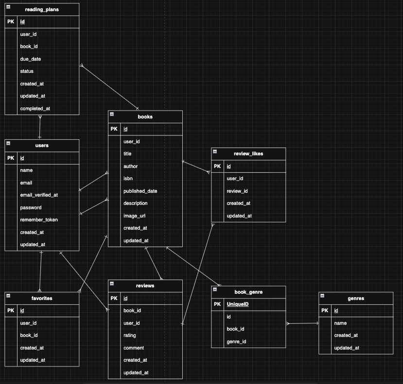

# BookShelf 書籍レビューアプリ

## プロジェクトの目的

実務を想定したWebアプリケーション開発と、曖昧な要件から自ら仕様を設計しPMと詳細を詰めるプロセスを経験する

## アプリ概要

書籍レビューアプリケーション「BookShelf」であり、
ユーザーは書籍を登録・閲覧し、レビューの投稿やお気に入り登録ができます。
ジャンルによる分類やレビューへのいいね機能、平均評価に基づくランキング機能も備えています。
外部アプリケーション向けの公開API（JSON）も提供します。

## ER図


## 環境構築手順
1. リポジトリをクローンする
```bash
git clone https://github.com/ta647/BookShelf.git
cd bookshelf-app
```

2. Google Books APIキーを取得する
	1. [Google Cloud Console](https://console.cloud.google.com/)にアクセスし、Googleアカウントでログインする
	2. 画面上部のプロジェクト選択から「新しいプロジェクト」を作成する（既存プロジェクトがあればそれを使ってもよい）
	3. 左メニュー「APIとサービス」→「ライブラリ」から「Books API」を検索し、有効にする
	4. 「APIとサービス」→「認証情報」→「認証情報を作成」→「APIキー」を選択し、発行されたキーをコピーする

3. `.env` を用意する
```bash
cp .env.example .env
```
以下の値を編集する
```
DB_HOST=mysql
DB_USERNAME=sail
DB_PASSWORD=password
GOOGLE_BOOKS_API_KEY=（取得したAPIキーを設定する）
```

4. 依存パッケージをインストールする
```bash
docker run --rm \
    -u "$(id -u):$(id -g)" \
    -v "$(pwd):/var/www/html" \
    -w /var/www/html \
    laravelsail/php84-composer:latest \
    composer install --ignore-platform-reqs
```

5. コンテナを起動する
```bash
./vendor/bin/sail up -d
```

6. アプリケーションキーを生成する
```bash
./vendor/bin/sail artisan key:generate
```

7. マイグレーションと初期データを投入する
```bash
./vendor/bin/sail artisan migrate:fresh --seed
```

8. フロントエンドをビルドする
```bash
./vendor/bin/sail npm install
./vendor/bin/sail npm run dev
```

9. ブラウザで http://localhost にアクセスする


## 使用技術

- PHP 8.5 / Laravel 10.x
- MySQL 8.4
- Docker / Laravel Sail
- Laravel Fortify（認証）/ Laravel Sanctum（APIトークン認証）
- Tailwind CSS / Alpine.js / Vite
- Google Books API（ISBN書籍検索）
- PHPUnit（自動テスト）
- Laravel Task Scheduling（日次バッチ処理）

## バッチ処理・通知仕様

| コマンド | 実行時刻 | 内容 |
|---|---|---|
| `app:expire-reading-plans` | 毎日 00:00 | 期日を過ぎた「進行中」の読書計画を「期限切れ」に更新する |
| `app:send-reading-plan-reminders` | 毎日 08:00 | 下記3タイミングでリマインダー通知を送信する |

リマインダー通知の発火タイミング：

| タイミング | 対象ステータス | 通知種別 |
|---|---|---|
| 期日3日前 | 進行中 | 予告通知 |
| 期日当日 | 進行中 | 最終リマインド通知 |
| 期日3日後 | 期限切れ | 再エンゲージメント通知 |

読書計画に関する補足仕様：

- 完了済みの計画は所有者でも編集不可（403）
- 期限切れの計画の期日を今日以降に更新すると、ステータスは「進行中」に戻る
- 計画の削除時は、紐づくリマインダー通知も手動で削除する（通知はPolymorphic関連のためDBのCASCADE制約が効かない）

## 作成者
舘岡藍加

## APIエンドポイント一覧
Sanctum / Fortify	
| メソッド | エンドポイント | 内容 | 認証 |
|---|---|---|---|
| GET | `/api/v1/books` | 書籍一覧を取得する | 不要 |
| GET | `/api/v1/books/{book}` | 書籍詳細を取得する | 不要 |
| POST | `/api/v1/books` | 書籍を登録する | 必要（Sanctum） |
| PUT | `/api/v1/books/{book}` | 書籍を更新する（所有者のみ） | 必要（Sanctum） |
| DELETE | `/api/v1/books/{book}` | 書籍を削除する（所有者のみ） | 必要（Sanctum） |

## 開発環境URL
・書籍一覧（トップ）：http://localhost/  
・書籍詳細：http://localhost/books/{book}  
・書籍登録：http://localhost/books/create  
・書籍編集：http://localhost/books/{book}/edit  
・ジャンル一覧：http://localhost/genres  
・ジャンル詳細：http://localhost/genres/{genre}  
・ジャンル登録：http://localhost/genres/create  
・ジャンル編集：http://localhost/genres/{genre}/edit  
・レビュー編集：http://localhost/reviews/{review}/edit  
・お気に入り一覧：http://localhost/favorites  
・ランキング：http://localhost/ranking  
・ログイン：http://localhost/login  
・会員登録：http://localhost/register  
・phpMyAdmin：http://localhost:8080  